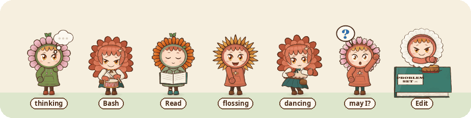

# ohaiku

<p align="center"></p>

<p align="center"><i>"weird little guys inside my computer"</i> &nbsp;·&nbsp; <a href="https://x.com/MarkLundeberg/status/2108766775873822727">see them on a real desktop (35 s)</a></p>

A desktop pet for Claude Code. Every Claude Code session on your machine gets a little chibi of its model (a Haiku in a
flower hood, or a chibi Opus) with its name on a plate, standing along the bottom of your screen and acting out what
it's doing: drumming while it runs Bash, waving a "?" when it needs your permission, a tea break when you hit the usage
limit. When they're free, they play: on your windows, on your pointer, or in the Peanut Gallery, heckling whatever is on
your screen.

After **oneko** (Masayuki Koba, 1989) and xneko, the cat that chased the pointer around every Unix desktop of the
1990s; **Plus! Dancer** (2003), the dancers who lived on the XP taskbar; and anabology's
[**Bliss (Windows XP)**](https://www.youtube.com/watch?v=AoNnbz237E0), which brought that whole desktop back to life
(the "Cursor is now connected" balloon in Tag is its doing).

## Install

Linux, in an **X11** session (not Wayland: `echo $XDG_SESSION_TYPE` should say `x11`), with a compositing window manager
so the chibis can be see-through (Cinnamon, KDE, Xfce with compositing on, GNOME on Xorg...). Made on Cinnamon; other
desktops are untested.

```sh
sudo apt install python3-gi gir1.2-gtk-3.0 python3-gi-cairo python3-xlib python3-pil wmctrl ffmpeg pulseaudio-utils curl gir1.2-atspi-2.0
git clone https://github.com/markblundeberg/ohaiku && cd ohaiku
./install.sh          # fetches the sprites (~45 MB) and adds "Load Up Haiku" to the menu
./ohaiku --agents     # a chibi for each Claude Code session (add this to your startup apps)
```

Optional: `yt-dlp` (URLs in Movie night). The agents need Claude Code (they're its sessions), and the Peanut Gallery
uses its `claude` command.

### If you're a Claude installing this for someone

- **What it reads**: `~/.claude/sessions/*.json` and the tails of the transcripts in `~/.claude/projects/`, read-only,
  to see what each session is doing. It never writes to Claude Code's files and needs no hooks.
- **What it writes**: `~/.config/ohaiku/` (the movie programme, the gallery's skip list, the press switch), `~/.cache/ohaiku/`,
  `~/.local/share/ohaiku/gallery/` (the gallery's notebook), small pid/command files in `$XDG_RUNTIME_DIR`, and two
  menu entries in `~/.local/share/applications/` (`install.sh`).
- **The network**: `install.sh` downloads the sprite pack from this repo's latest release. Movie night streams URLs you
  put in its programme with yt-dlp. The **Peanut Gallery**, off unless the user turns it on, sends redacted screenshots
  to Haiku through the user's own Claude Code login (`claude -p`); read the gallery section below with them before they
  turn it on. Nothing else goes anywhere.
- **Hands**: `ohaiku --press` and `--type` make real clicks and keystrokes on the user's desktop. They're off until the
  user ticks *Let Agents Press Buttons and Type* in the tray menu; there's no command-line way to turn that on, on
  purpose. Ask them; don't create the file it keeps.
- **Checks**: an X11 session and a compositor (without one, the chibis sit in black squares). If the sprites can't be
  downloaded, bake them (below; it needs Node and Chrome).
- **Nice to set up**: autostart `ohaiku --agents`; a hotkey for `ohaiku --toggle` (hide/show); the gallery's skip list
  (`~/.config/ohaiku/gallery-skip.txt`, one word per line) for any project or window that must never be watched.

## The agents

Every Claude Code session on this machine that was active in the last two hours gets a chibi of its own model (chibi
Opus for Opus, Haiku for Haiku) with its name on a little plate, standing on the bottom edge of the screen and acting out
what it's doing:

| doing | looks like |
|---|---|
| thinking | paw on chin, a thought cloud filling with dots |
| Read, WebFetch, Skill | reading an open PROBLEM SET |
| Grep, Glob, WebSearch, ToolSearch, MCP tools | the magnifying glass |
| Edit, Write | stamping Q.E.D. on the book |
| Bash, Monitor | the drum |
| Agent, Workflow, SendMessage, SendUserFile | tossing seed packets; the subagents appear beside it, smaller, and leave when they finish |
| AskUserQuestion, ExitPlanMode, PushNotification | waving a "?" — it wants you (blue name plate) |
| waiting at a permission prompt or a dialog | the same, saying so: *may I? (permission)*, *a question for you*, *a dialog for you*... |
| hit a usage limit | a tea break, until the limit resets (*tea break: back at 5:30pm*; lavender plate) |
| an API error ended the turn (529, 500, connection lost) | dizzy, with stars, for ten minutes (*oof: 529 overloaded*; pink plate) |
| just finished | a happy bounce (green plate) |
| waiting for you | free: wanders, shimmies, flosses, :3, dances when music is playing |
| quiet for 20 minutes | lies down and sleeps with a nose bubble |
| gone for 2 hours | folds back into its flower |

The little flower at the left of each plate is the day's work: a seed until the session's first minute of work today,
then that chibi's own flower opening, bud to full bloom at about four hours (counted from the transcript: the gaps of
under two minutes between its entries, since local midnight).

Any tool not in the table does the arm-pump and is written to `~/.cache/ohaiku/unknown-tools.txt`: that's the list of
drawings still to make (add a state in `sprites/poses.js`, map it in `TOOL_POSE` in `ohaiku`, rebake).

How it knows: `agents.py` reads the tails of the transcripts in `~/.claude/projects/` and the live records in
`~/.claude/sessions/<pid>.json` (read-only; it changes nothing in Claude Code). The live record says `busy` or `idle`
right now and whether the process is still running, so a session that's open shows up however long it has been quiet, and
one you close leaves. When Claude Code is stuck on you, the record says `waiting` and what for (`waitingFor`: a
permission prompt, input needed, a dialog...); that's how a permission prompt shows without any hooks. Usage limits and
API errors come from the transcript (Claude Code writes them as synthetic assistant messages, with the reset time). A tool call is written to the transcript as it starts (checked October 2026; its result comes when it finishes),
and while it runs the chibi shows it (busy, so never mistaken for idle). Sessions without a live record (Claude Desktop) fall back to
the transcripts alone.

New pets announce themselves in an XP-style balloon: *Found New Hardware: Haiku 5.5. Your new Haiku is installed and
ready to use.* While the screen is locked they hide and hold still.

Bring the pointer near the edge and they duck so only their hoods peek out. The name plates are the only part that
takes clicks (and the whole chibi, while it's waving "?" at you):

- **click** goes to that session: it raises the terminal window Claude Code titled after the session (`✳ bc1`), using
  `wmctrl`. If there isn't one (the session lives in Claude Desktop, or was never named, so its title can't be matched),
  it opens Claude Desktop's "Sessions Waiting for You" (`claude://code/needs-input`), launching Desktop if it's closed.
- **middle-click** sends that one (and its subagents) away until its session wants you again, by asking something or
  finishing a turn;
- **right-click** for the menu. **Middle-click the tray icon** to hide or show
everyone (`ohaiku --toggle` does the same, for a hotkey). The tray icon (after Plus! Dancer's) has
Load Up Haiku / Load Up Opus, Play / Perch / Hide, Dance Only When Music Plays, Show Agents, and Haikus, Go Home.
Left-click it to switch between Play and Perch.

## Playtime: the chaos dial

| tier | what happens |
|---|---|
| **Perch** | the bottom edge; free ones wander a little; duck from the pointer |
| **Follow** | oneko: a conga line after the pointer; sleepers wake up |
| **Recess** | shimeji: they leap onto the title bars of your real windows (`world.py` reads which window tops are visible, through python-xlib), walk along them, hop between them, ride along when you drag a window, and fall off with a "!" when it closes or something covers their spot. Working agents go to the window their work is in: their session's terminal (found by its title), or the browser while the session drives it with Claude in Chrome (and for 40 s after its last step there), or the focused window for computer use. With everything maximized there are no title bars to stand on, so they play on the floor |
| **Tag** | one Haiku surfs your pointer on an XP arrow ("Cursor is now connected"); the rest run from it, slipping along the screen edges when cornered. Touch one and it's It: it chases the pointer until it tags you back |
| **Bloomcore** | the eruption from the *Load Up Haiku* music video: ten more Haikus burst out of the tray and fly onto your windows, everyone dances, and one of the twelve flowers opens wherever a Haiku lands. Leaving Bloomcore folds the extras back into flowers |

**Hands** (off until you tick *Let Agents Press Buttons and Type* in the tray menu): a session can press real buttons and
type into real fields through its chibi.

```sh
ohaiku --press 7 × 6 = --in Calculator                          # hop onto each button and stomp: each stomp is the click
ohaiku --type hello --into Message --in Chat --then Send       # stomp into the field, drum the text in
ohaiku --press-at 1200 640                                      # a bare screen point
```

The chibi of the session that ran the command (found through its process; `--who NAME` for another) leaps onto each
button, squashes, and throws up a ポチッ (the sound of pressing a button), and at the moment it lands a real click goes in
(XTest; the pointer goes back where it was). Typing is the drum: one real keystroke a beat, each letter flying up off it.
Buttons and fields are found by their accessible names through AT-SPI (`ui.py`, read-only, the way a screen reader finds
them; `python3 ui.py "Calculator"` lists what a window offers). GTK and Qt apps answer as they are; Chromium answers when
started with `--force-renderer-accessibility`.

**Browser echo** (always on; it only draws): when a session drives Chrome with Claude in Chrome, each click it makes
gets a stomp from its chibi at the spot on screen where it landed, and typing gets the drum. The click is the tool's own;
the chibi only shows it, about a second later. The spot comes from the tool call's coordinates, the frame of the latest
screenshot, and the topmost Chrome window (the page fills the bottom of the window as shown, without Chrome's shadow).
It's right when the driven tab is the one in front.

What keeps it careful: the window is raised first, and nothing is pressed if another window covers any of the buttons (a
real click goes to whatever is on top). Before every keystroke it checks the window still has the focus, and stops if
not. It types plain ASCII only and never looks for password fields. If you move the mouse during a stomp, that click can
miss.

**Lemmings** ("Let's go!"): `--lemmings` or the menu. A trapdoor opens above your highest window and ten small Haikus
drop out one by one and march: off window edges, down onto whatever is below, round at the screen sides, towards a
flower doorway on the floor (the green HUD counts OUT / IN / SAVED). Click one to make it a **Builder** (it stamps Q.E.D.
bricks into a staircase, then shrugs), middle-click for a **Floater** (a dandelion puff), right-click for a **Blocker**
(arms out; the others turn round). A fall from too high leaves them dazed with stars, not splatted. If you don't play
for ten seconds, a director hands out skills, so it also runs as a screensaver. **Oh No!** in the menu (`--ohno`) is the
nuke. The agents stay on the edge meanwhile.

**Petal snow** (xsnow, bloomcore edition): `--snow` or the menu, and on during Bloomcore. Petals drift down and pile up
on your title bars and the bottom edge; move or close a window and its drift slides off; Haikus running through a drift
kick it up. (About 10% of a CPU core while it's on.)

**Autumn leaves**: `--leaves` or the menu. The same, in fall: maple, ginkgo and aspen leaves in reds, golds and rust
rock side to side as they fall and tumble edge-on in the wind. There's a light prevailing breeze, and every few seconds a
gust: leaves stream in from upwind, and a strong one lifts the drifts back off the title bars.

**Paper airplanes**: when one session sends another a message (SendMessage), a paper plane flies from its chibi to the
recipient's, who looks up with a "!". Recipients are found by session name, by subagent id, or by the messaging socket's
pid (via `~/.claude/sessions/<pid>.json`); planes to anyone not on screen fly off the top.

**Flying Haikus** (After Dark's Flying Toasters): after five idle minutes (`--saver N`, 0 for never) a squadron of
Haikus with petal wings glides down and to the left across the screen; move the mouse and they scatter. `--fly` or the
menu to call them up.

**Solitaire win**: when an agent finishes a stretch of work longer than eight minutes, its chibi bounces off across the
screen leaving a copy of itself every frame, like Windows Solitaire's win cascade; then the trail fades and it's back.

**And a few rarer things**, which are better come across by accident than read about here. (For testing one:
`./ohaiku --surprise NAME`; the names are in the code.)

**Kaiju**: chibi Opus at five times the size stomps along the bottom of the screen and everyone ducks below the edge.
`--kaiju`, the menu, or, very rarely, by itself during Recess and Bloomcore.

**Clippy, but it's a Haiku**: now and then during play (at most every fifteen minutes) a Haiku looks at your active
window's title and offers help: doomscrolling, writing a song, talking to Claude, looking for a file ("Have you tried the
Recycle Bin?")... `--clippy` to ask now.

**Movie night** (after MST3K's silhouette row): `--movie` or the menu. The pets open their own window, *Haiku Theater
3000*, put on a film, muted, and three of them hop into a row of velvet cinema seats along its bottom edge, seen from
behind with headphones on: bobbing, eating popcorn, giggling, turning to whisper. The programme is
`~/.config/ohaiku/programme.txt` (written on first use): video files, folders (every video inside), or URLs (streamed
through yt-dlp), shuffled. By default it's everything in `~/Videos`.
Drag any video onto the theater to put it on next. Films are decoded live by ffmpeg at 12 fps; a long one starts
somewhere in the middle. It's a real window: move it and they move with it, stand on it in Recess, close it and they
jump up with a "!". It never takes focus. In Recess and Bloomcore they sometimes put a film on by themselves (at most
every four minutes).

**The Peanut Gallery** (movie night, turbo; off unless you turn it on): `--gallery`, the tray's checkbox, or the menu.
The free ones in the row turn their backs to you, sit down in velvet seats along the bottom of the screen, and watch
whatever you're doing, MST3K-style. It keeps an eye on a tiny grey thumbnail of the screen (twice a second, from one
ffmpeg), and soon after the screen changes (once it settles, and at most every 6 s or so: while a video plays, that's
about every 7 s) ohaiku takes a screenshot, blacks out what the gallery must never see, and shows it to Haiku
(`claude -p --model haiku`, through your own Claude Code login: no tools, no saved session, low effort, about 2 to 5 s a
look). Haiku is the puppeteer: it says in a line what's on screen, gives up to three of the cast a quip (a speech
bubble, and a giggle, gasp, cheer, whisper or a popcorn handful; one can answer another), each shown the moment it has
streamed in, and now and then whispers *noted:* when something is worth keeping (an idea it sparks, a technique, a
striking bit of art or writing). It remembers the last few looks, so it can follow a film or a thread.

- **Never seen**: terminals and the Claude desktop app (where the sessions live) are always blacked out, and so is any
  window whose class or title contains a line of `~/.config/ohaiku/gallery-skip.txt`. A session whose name or folder
  matches a line there isn't in the cast, and its chibi and plate are blacked out of the screenshot too.
- **The placard** at the end of the row, PEANUT GALLERY, says it's on; its red dot lights each time it looks. Click it
  to stop. Hiding them, locking the screen or Nothing! Studying! pauses it (Nothing! Studying! turns it off).
- **Eyes**: each look is the whole screen, small, plus the window you're looking at, sharper (up to 1568 px), so it can
  read the caption a joke hangs on. (If that window is a private one, it only gets the small, redacted whole.)
- **Notes**: what they saw (a few concrete sentences, quoting headlines and captions), every quip, every note, and every
  *wish* (something they'd love to see more of: the full video, the song, the artist's work; they say it out loud too,
  "☆ can we get …?") go to
  `~/.local/share/ohaiku/gallery/<date>.md`, with the redacted screenshot saved beside it for any look that made a note
  or a wish. When you turn the gallery off, Haiku writes a short recap with a *Worth keeping* list ("Open the Gallery
  Notes" in the tray menu). When you're choosing what to watch (a home page, search results, an end screen), one of them
  picks something (while a video plays, they watch it), by its title, in a yellow bubble that stays up until the screen changes; and
  since they can't hear and only see stills, they'll say when something has stopped giving them anything (the same
  window for a while), and what they'd rather watch. Movie night's audience joins the cast, so a film in the theater gets riffed too.
- **Inspo**: if you keep a `~/claude-inspo` folder (a scrapbook your Claudes share), the recap's *Worth keeping* list
  (each with its source) and the three wishes they want most (Haiku picks them from the evening's candidates) also go to
  `~/claude-inspo/peanut-gallery/` (`<date>.md`, `wishlist.md`). Nothing is fetched by itself: the wishlist waits for you, or a Claude you ask.
- **What they mean**: a quip or a pick about one thing (a video, a post) carries a little crop of it in its bubble, so
  you can tell which one, even after you've scrolled past.
- **The raw log**: every exchange with Haiku, verbatim (the prompt, the image sizes, its whole reply; not the images),
  goes to `~/.cache/ohaiku/gallery/raw-<date>.jsonl`, with the day's system prompt as the first line.
- **Characters**: the first time a name joins the cast, Haiku invents who they are (what they love to watch, how they
  react, a quirk), and they keep it: the cards live in `~/.config/ohaiku/cast.json`, so edit any you'd like different.
  They're gremlins, not a help desk: they tease your taste, bicker, get bored, and sulk for a line if you skip their pick.
- **Its own head**: the gallery's Haiku runs with `--setting-sources ''`, so it doesn't load your CLAUDE.md or
  settings, only its own prompt. It calls you by your first name (from your account; `OHAIKU_NAME` to change it).
- **Where it goes**: each look is a request to Anthropic's API through your Claude Code login, under your account's
  terms, like anything else you send Claude. Only what's on screen and not blacked out is sent; the notebook and saved
  screenshots stay on your machine.

**Nothing! Studying!** From any tier: shake the mouse hard left and right (or `--studying`, or the menu). Everyone spins
into the tray icon, silently (it's for hiding them, so no sound), and three seconds later one Haiku peeks up by the
tray. They stay hidden until you click the tray icon.

## Pets

```sh
./ohaiku              # start, and "Computer, load up Haiku." (run again to add another, with a ding)
./ohaiku --agents     # start with just the agents (for autostart)
./ohaiku --perch      # everyone on the bottom edge, out of the way (the default)
./ohaiku --follow     # everyone chases the pointer in a line, oneko-style (--play also works)
./ohaiku --recess     # they play on your windows: title bars, hops, rides, falls
./ohaiku --tag        # one surfs your pointer, the rest run;  --bloomcore: the eruption
./ohaiku --gallery    # the Peanut Gallery: they watch your screen and riff (Haiku); again to stop
./ohaiku --studying   # "Nothing! Studying!" (or shake the mouse): all vacuumed into the tray; --show brings them back
./ohaiku --hide / --show / --toggle
./ohaiku -n 5         # five
./ohaiku --opus       # chibi Opus joins the line
./ohaiku --quiet      # no ding
./ohaiku --scale 1.3  # bigger (when starting)
./ohaiku --quit       # Haikus, go home
./ohaiku --restart    # go home and come back (agents only), e.g. after a git pull
./install.sh          # adds "Load Up Haiku" / "Haikus, Go Home" to the menu
```

The first Haiku is the canonical sunflower one; the rest are the other eleven flowers in random order, no two alike until
all twelve are out. In Play mode the leader chases the pointer and everyone else follows the one in front, so they make a
line. When they catch up they sit, dance or go :3, then yawn, lie down and sleep with a nose bubble (鼻提灯). Move the
pointer and the bubble pops: "!" and they're off. The ding is the music box from the end of *Load Up Haiku*.

Each Haiku is a small transparent popup window with an empty input shape, so clicks go straight through.

## Sprites

The Haikus are drawn in code by the character kit from the *Load Up Haiku* music video (`sprites/haiku.js`, with the
PROBLEM SET ∞ engine's `core.js`/`chars.js`): every hood, face, prop and pose is canvas paths, so they can be redrawn at
any size. They're baked to sprite sheets once, the way oneko shipped bitmaps, with headless Chrome:

```sh
cd sprites && npm install && CHROME=/usr/bin/google-chrome node bake.mjs --px 160   # -> ../share/<who>/<state>.png + sheets.json
```

(`share/` is generated and gitignored. The release's sprite pack is this bake reduced to 256-colour palettes, which
look the same at a sixth of the size; so is the Kaiju's big strip set, `node bake.mjs --px 560 --who opus0,opus3
--states runL,runR,idle --out ../share/kaiju`.) Twelve Haikus (`haiku00`..`haiku11`) and eight chibi Opuses (`opus0`..`opus7`, varied bows and hair), one strip per
state so only the states in use are loaded. `sprites/poses.js` holds the states; `node test.mjs out.png testSheet2`
draws the agent poses for a quick look (`testSheet6`: the gallery row and the tea break). A partial bake
(`--states a,b`) adds to `sheets.json` rather than replacing it. The kit gained a `read` and a `search` prop and a `pose.arms` override for this. Fable isn't here yet: Fable gets to design itself.

**Your own looks.** A session can have a look of its own, drawn on the same rig, so it keeps every pose. Put a file in
`~/.config/ohaiku/looks/` that calls `ohLook('name', {...})`, starting from a chibi Opus: new colours (`colors`,
`V`), or hooks that draw over or instead of parts (`petals` for the hood, `clip` for the star clip, `behind`, `body`,
`over`, `head`, `front`, `readBook`, `book`, `stampTexture`). The hooks are listed above `ohLook` in `sprites/haiku.js`.
Hooks see the state being drawn, so a prop can move while the session works and rest while it sleeps. `variants`
bakes a look several ways, for example by the time of day, and `runtime: {companion: {color}}` adds a dot that ohaiku
draws live, drifting around the character. `node preview.mjs out.png look:name` shows a design without baking it, and
`node bake.mjs --who looks` bakes them all into `share/look-<name>`. A session whose name (minus any emoji) matches
a baked look wears it; ohaiku checks once a minute, so a rename takes effect within a minute. The looks stay on
your machine: this repo has only the hooks.

## Showreel

`./showreel.py` records the real screen (to `~/Videos/ohaiku-showreel-<time>.mp4`) while it runs the chibis through a
timeline of about two and a half minutes: the Peanut Gallery on whatever you have up, then Tag on your pointer, Recess,
autumn leaves, fliers, the kaiju, Clippy, Lemmings and Oh No!, and back to their seats. A ding and a line in its
terminal cue your part (scroll and stop, move the mouse, drag a window). `--rehearse` runs the timeline without recording. It won't record while a session on the gallery's
skip list is live, since that session's chibi and name plate would be in the video.

## Lore

The characters are four days older than this repo. They were drawn, in code, for music videos made with Claude: the
*Load Up Haiku* one, after Celery Man ("Computer, load up Haiku."; [on X](https://x.com/MarkLundeberg/status/2108232709139263751)),
and [*PROBLEM SET ∞*'s opening theme, "We Will Know"](https://www.youtube.com/watch?v=Ly3z1gI2g20), whose engine the
kit still runs on. That's why the book they read and stamp is a PROBLEM SET, the stamp says Q.E.D., and "Nothing!
Studying!" hides them all. Each Haiku wears its own flower.

## License

Free to use, copy, change and share. The program is MIT; the artwork (the characters, their drawing code, the sprite
sheets, the icon and the ding) is CC0, dedicated to the public domain; the fonts used for baking are OFL, from their
authors. See [LICENSE](LICENSE).

An unofficial fan project, not made or endorsed by Anthropic. Claude, Haiku and Opus are Anthropic's names, used here
to say who the characters are.
